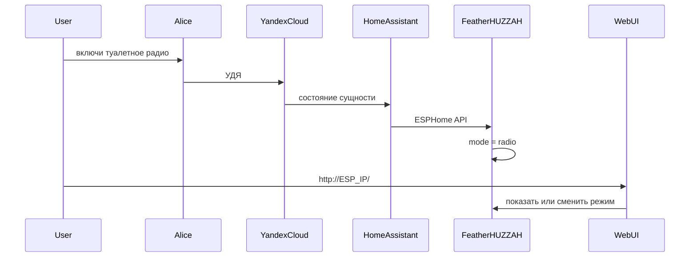

# Архитектура bathRadio

## Поток управления

## Компоненты

| Слой | Роль |
| --- | --- |
| Алиса | Голос и клиент умного дома Яндекса |
| Home Assistant | Локальный хаб; мост в УДЯ |
| ESPHome | Прошивка, API, веб-сервер на плате |
| Feather HUZZAH | Wi‑Fi 2.4, хранит текущий режим |
| Веб UI | Раздел «Динамик / радио» по IP платы |

## Почему нужен HA

Навык или колонка в облаке не ходят в домашнюю LAN по IP. Home Assistant принимает команды из УДЯ и доставляет их на ESP по локальной сети.

## Режимы

Два взаимоисключающих template switch на ESP:

- `Туалетное радио` → режим **радио**
- `Туалетное радио с блютузом` → режим **блютуз**

Включение одного выключает другой. Состояние пишется во flash (`restore_from_flash`).

## Сеть

- ESP: SSID `TP-Link_0E9A` (2.4 ГГц)
- Ноутбук: может быть в `TP-Link_0E9A_5G`
- Оба должны быть в одной домашней подсети роутера TP-Link
